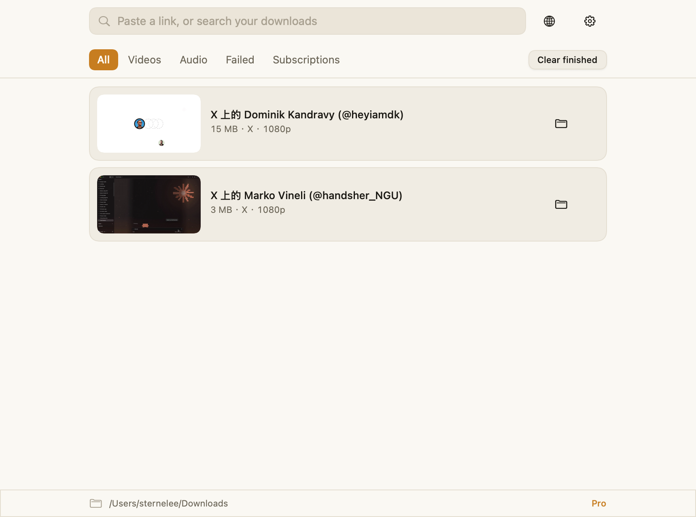
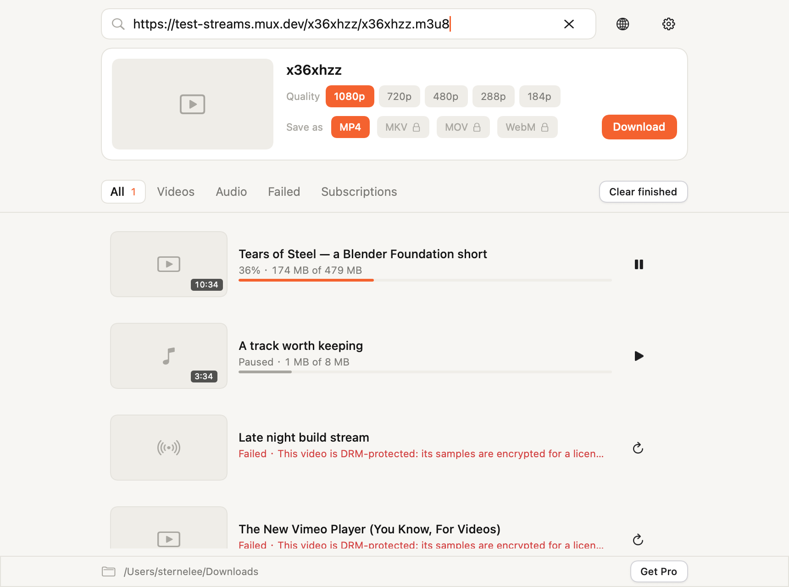
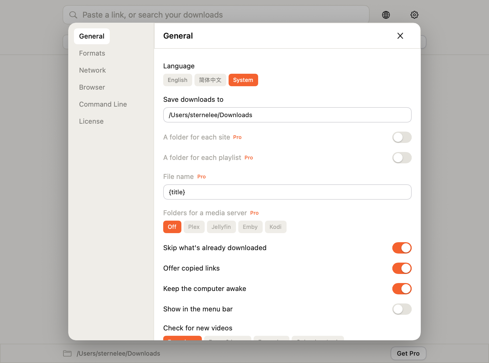
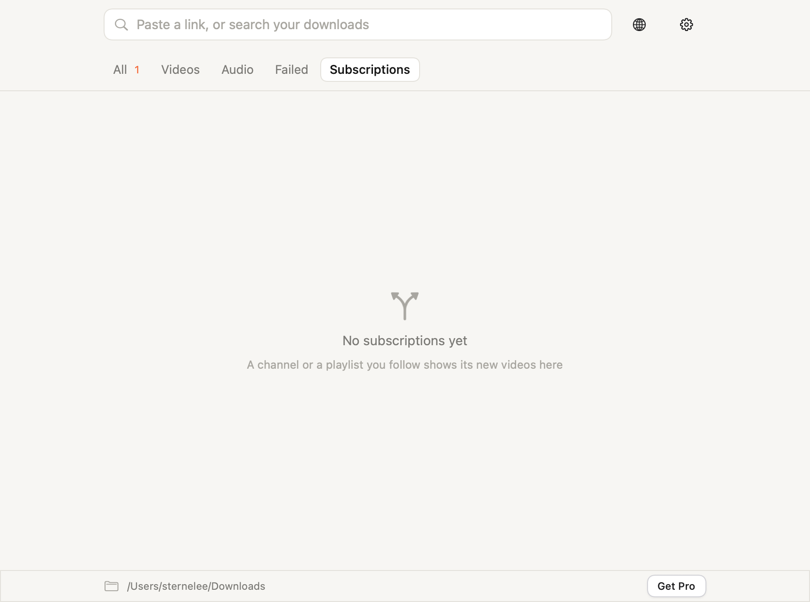

# nanodown

A desktop video and audio downloader in Zig, on nanoui's native UI. A link in,
a file out: the same binary is the window and the command, as downbit's is.

    zig build
    zig-out/bin/nanodown                       # the window
    zig-out/bin/nanodown get <url> -o ~/Movies # the command
    zig-out/bin/nanodown --help

The full specification it was built to is in [PRD.md](PRD.md).

## What it does

**The window.** One field takes a link or a search (⌘L focuses it). A link is
read at once: cover, title, what it comes in, and the button that starts it.
Return downloads. The library below lists what is running and what is done, with
a bar that takes the picture's own colour as it fills, and tabs for All, Videos,
Audio, Failed and Subscriptions. ⌘F searches the titles, ⌘1–⌘4 pick a tab,
⌘⇧K clears what finished, ⌘, opens the settings.

**The command.** `get`, `info`, `formats`, `list`, `subs`, `settings`, `sites`,
`open`. Every one takes `--json`. It reads the app's own settings and library,
so what it downloads shows in the window.

**The engine.** No yt-dlp, no FFmpeg, no Python. Pages are read for the formats
they declare; a link that is itself a master playlist is read for its
renditions, so `-q` picks a real one rather than the highest; HLS and DASH
manifests are expanded into their segments; segments
are fetched over several connections at once, into a `.part` file that a pause,
a quit or a dropped connection resumes from. An HLS playlist whose segments
share one file by byte range (`#EXT-X-BYTERANGE`, how Apple ships fMP4) is
fetched range by range, and its `#EXT-X-MAP` init segment goes first. Separate
video and audio tracks are merged into one MP4 by writing the boxes
(`src/engine/mux*.zig`), with the title, artist, date, link and cover in its
metadata. A fragmented MP4 is left as the stream wrote it: its samples live in
`moof` pairs the muxer does not rebuild, and the video is worth more than the
tags.

**Sites that sign their URLs.** YouTube does not put a plain URL in the page:
its formats sit behind a signature only its own player can produce. When a page
lists formats with no URL, the app opens it in a window it never shows, lets the
site's own player run, and takes the media requests the player makes
(`src/engine/capture.zig`, `src/capture_flow.zig`). Each URL it takes is tried
with a request of this engine's own before it is offered, so the quality list
never holds one whose Download button would fail.

## What it does not do

- **DRM.** Netflix, Disney+, Spotify and the like are not downloadable, and the
  app does not pretend otherwise. Vimeo is the one that catches people out: its
  player config hands out an HLS playlist whose master names no key, and whose
  media playlist under it says `METHOD=SAMPLE-AES,URI="skd://drm"`. The key is
  a licence server's, so the playlist is read, the encryption is seen, and the
  refusal comes before a byte is fetched rather than after a file that will not
  play. `AES-128` with a plain key URL is a different thing and is not refused.
- **YouTube downloads.** The capture above works for sites that hand their
  player a signed URL. YouTube now hands its web player a binary protocol
  (`serverAbrStreamingUrl`, `application/vnd.yt-ump`) instead, and the plain
  `videoplayback` URLs it also requests are signed for the address of the
  machine that asked, not for yours. The format list is read and shown as the
  site gives it, and the preview says plainly that the stream cannot be taken
  rather than failing obscurely. Sites that do hand out a URL (Vimeo's HLS,
  direct MP4s, most others) download normally.
- **Conversion.** The formats a site offers are the formats you get. There is no
  transcoding, because there is no FFmpeg: MP4 and M4A are what the engine can
  write.

## Layout

```
src/main.zig          the entry: arguments mean the command, none means the window
src/app.zig           the app's state: library, settings, licence, the queue
src/view*.zig         the window: the field and list, a row, the preview, settings
src/model/            media, download, library, settings, subscription, licence
src/engine/           http, hls, dash, extract, page, mux, job, capture
src/capture_flow.zig  the hidden player, its media requests, the formats it named
src/store.zig         the state files, and the string work a file name needs
src/cli.zig           the command
src/theme.zig         the palette, light and dark, in nanomon's warm ground
src/tests.zig         every module's tests, through ui.Tester for the views
docs/shots/           the screenshots below
```

## Screenshots

| | |
|---|---|
|  |  |
|  |  |

## Packaging

    VERSION=0.1.0 sh macos/package.sh

Builds `nanodown.app` and `nanodown-macos-arm64.dmg` into `zig-out/package`,
plus the `nanodown-macos-arm64.zip` and `manifest.json` an updater reads. The
bundle is ad hoc signed unless `CODESIGN_IDENTITY` names a Developer ID, and
notarized and stapled when `NOTARY_PROFILE` or the App Store Connect key
variables are also set. macOS 13 on Apple silicon, from the M1 on.

The icon is drawn rather than shipped as a binary: `python3 macos/make-icon.py`
rewrites `macos/AppIcon.icns` from the same warm charcoal and amber the window
uses.

## Tests

    zig build test

The views are tested without a window through `ui.Tester`, which renders
offscreen; the engine's tests use small fixtures rather than the network. A real
download can be checked headlessly:

    zig-out/bin/nanodown --nanoui-snapshot=/tmp/shot.png --nanoui-hidden \
      --nanoui-script="click:Paste a link, or search your downloads;type:<url>;key:enter;live:3;click:Download;live:14"
